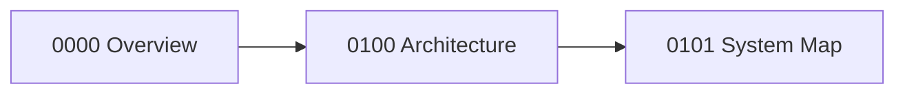

# Mermaid Diagrams

Use only when a diagram improves understanding.

Rules:

- Keep diagrams small and named by surrounding heading.
- Define nodes before edges.
- Prefer stable IDs and readable labels.
- Avoid duplicating prose in the diagram.
- Add a short text summary before or after each diagram.

Preferred types:

- `flowchart` for documentation routes;
- `graph` for dependencies;
- `sequenceDiagram` for API or event flows.

Example:

