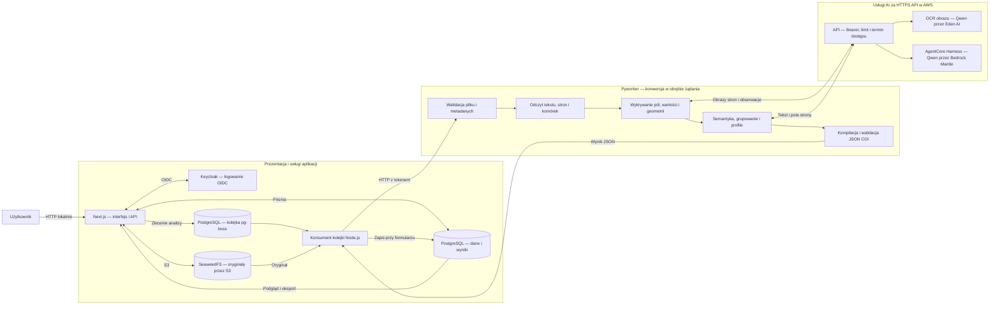

# FORMIQ

## Uruchomienie projektu w Dockerze

Wymagany jest Docker Engine z Docker Compose 2.24.4 lub nowszym. Polecenia wykonuj z głównego katalogu repozytorium.

**Wszystkie polecenia Compose wykonuj z poziomu root tego projektu**, czyli katalogu zawierającego `README.md`, `compose.yaml` i `.env.poc`. W tym samym katalogu utwórz `.env.poc.local`. Przed uruchomieniem przejdź do niego w terminalu, np. `cd formularze`.

### 1. Uzupełnij dostęp do Harness API

**Plik musi nazywać się dokładnie `.env.poc.local` i znajdować się w root projektu, obok `compose.yaml`.** Compose wymaga tej nazwy i lokalizacji, aby polecenie `docker compose up --build -d --wait` zadziałało. Upewnij się, że plik nie ma dodatkowego rozszerzenia, np. `.txt`.

Utwórz w głównym katalogu plik `.env.poc.local` i wpisz otrzymany adres HTTPS oraz klucz API:

```dotenv
PYWORKER_HARNESS_API_URL=https://ADRES_TWOJEGO_API/
PYWORKER_HARNESS_API_KEY=TWÓJ_KLUCZ_API
```

Plik `.env.poc.local` jest ignorowany przez Git. Compose odczytuje ten plik oraz publiczny `.env.poc`. Zmienne powłoki mają pierwszeństwo. Uwierzytelnianie klienta odbywa się kluczem Bearer do endpointu AWS.

Pozostałe ustawienia są gotowe w publicznym [pliku .env.poc](.env.poc). Zawiera on porty, nazwy obrazów i wolumenów, jawne lokalne dane PoC oraz stałą datę wygaśnięcia usługi. Klucz API musi być aktywny. Po upływie `PYWORKER_HARNESS_EXPIRES_AT` kontrola startowa zgłosi wygaśnięcie dostępu. Odnowienie wymaga autoryzowanej zmiany terminu również po stronie AWS.

### 2. Uruchom Docker Engine

Na Windows uruchom Docker Desktop w trybie kontenerów Linux i poczekaj na gotowość silnika. Możesz sprawdzić połączenie z silnikiem poleceniem:

```bash
docker info
```

### 3. Zbuduj i uruchom cały stack

```bash
docker compose up --build -d --wait
```

Usługa startowa Compose sprawdza konfigurację API i termin dostępu. Compose buduje obrazy Web, kolejki, pyworkera i infrastruktury. Następnie uruchamia PostgreSQL, Keycloak i SeaweedFS, wykonuje migracje, seed bazy oraz kont w Keycloak i uruchamia aplikacje. Czeka na gotowość kontenerów. Pierwsze uruchomienie pobiera obrazy i zależności, więc może potrwać kilka minut.

Po zakończeniu komendy otwórz **http://127.0.0.1:4100**.

(PoC — użytkownik: `admin`, hasło: `admin`; konto zwykłego użytkownika: `user`, hasło: `user`.)

| Usługa PoC | Adres                                                                                               |
| ---------- | --------------------------------------------------------------------------------------------------- |
| Aplikacja  | [127.0.0.1:4100](http://127.0.0.1:4100)                                                             |
| Keycloak   | [127.0.0.1:10800/admin/](http://127.0.0.1:10800/admin/)                                             |
| OIDC       | [Konfiguracja realmu FORMIQ](http://127.0.0.1:10800/realms/FORMIQ/.well-known/openid-configuration) |
| S3         | `http://127.0.0.1:28333`                                                                            |

| Użytkownik | Hasło | Rola |
| ---------- | ----- | ---- |
| admin      | admin | ROOT |
| user       | user  | USER |

PoC używa HTTP pod adresem `127.0.0.1`, więc nie wymaga certyfikatów ani ich importowania do przeglądarki. Używaj tego adresu także do logowania, aby ominąć wcześniejsze HSTS zapisane dla `localhost`. Dane PoC są przechowywane w wolumenach projektu `formiqpoc`. Ponowne wykonanie komendy zachowuje dane i istniejące konta.

Przetwarzanie korzysta z endpointu AWS obsługującego OCR i projektowanie formularzy. Klucz dostawcy OCR pozostaje w konfiguracji serwera AWS. Publiczny `.env.poc` zawiera jawne dane przeznaczone do lokalnego PoC. Porty aplikacji i infrastruktury są publikowane na loopbackie, a wolumeny są odrębne od DEV i zwykłego QA.

Szczegółowe instrukcje opisują [Docker Compose PoC](docs/0307-docker-poc.pl.md) oraz [Harness API i termin dostępu](docs/0209-harness-api.pl.md).

FORMIQ to pracownia do cyfryzacji formularzy. Wynikiem analizy dokumentu jest konfiguracja formularza JSON COI oraz odczytana treść dokumentu.

Przykładowy JSON wygenerowany przez naszą aplikację znajduje się w katalogu [json-example](json-example/).

[Uruchomienie](#uruchomienie-projektu-w-dockerze) · [Test krok po kroku](#jak-przetestować-aplikację-krok-po-kroku)

## O projekcie

FORMIQ pomaga urzędnikom zamieniać papierowe formularze, skany i dokumenty biurowe w formularze elektroniczne. Rozpoznaje pola, tabele, wpisane wartości i teksty informacyjne, a następnie buduje konfigurację JSON z sekcjami, zależnościami i odniesieniami do źródła. Użytkownik porównuje wynik z oryginałem, poprawia odczytane dane i eksportuje JSON.

To działający PoC przygotowany dla wyzwania COI „Cyfryzacja formularzy”. Obsługuje PDF, DOC, DOCX, XLSX, ODS, JPG, JPEG i PNG. Wariant uruchamiany domyślnie przez Compose korzysta z API w AWS. Dostępny jest również osobny wariant lokalnego przetwarzania. Potwierdzenie importu do rzeczywistego systemu COI i odbiór wariantu offline pozostają otwarte.

## Prezentacja

[Otwórz prezentację projektu — presentacja.pdf](presentacja.pdf)

## Zespół

Skład i zakres prac odpowiadają [stronie zespołu w aplikacji](http://127.0.0.1:4100/pl/about/team). Jej [kod](apps/web/src/app/[locale]/about/team/page.tsx) korzysta ze [wspólnej konfiguracji zespołu](apps/web/src/config/team.ts).

| Osoba           | Rola i zakres prac                                                                    | Profile                                                                                               |
| --------------- | ------------------------------------------------------------------------------------- | ----------------------------------------------------------------------------------------------------- |
| Kacper Boś      | Architekt i lider projektu — architektura rozwiązania i kierunek techniczny.          | [LinkedIn](https://www.linkedin.com/in/kacper-boss) · [GitHub](https://github.com/bos-8)              |
| Jakub Mielcarek | AI Lead, UI/UX — funkcje AI i ich połączenie z interfejsem użytkownika.               | [LinkedIn](https://www.linkedin.com/in/mielcarekjakub/) · [GitHub](https://github.com/vGiacomov)      |
| Natalia Balicka | Project Owner, Project Manager — koordynacja prac, komunikacja i organizacja zespołu. | [LinkedIn](https://www.linkedin.com/in/natalia-balicka) · [GitHub](https://github.com/balickanatalka) |
| Yurii Holovko   | Senior Developer, Trainer — rozwój frontendu i udostępnianie funkcji AI w aplikacji.  | [LinkedIn](https://www.linkedin.com/in/yurii-holovko/) · [GitHub](https://github.com/Yurich3112)      |
| Stanisław Wałga | Mid Developer, CI/CD — backend, logika serwerowa, obsługa danych i pipeline.          | [LinkedIn](https://www.linkedin.com/in/stanislaw-walga/) · [GitHub](https://github.com/Aglawxd)       |

## Architektura i przepływ danych

Lokalny PoC używa HTTP na loopbackie, a zewnętrzne wywołania AI są szyfrowane przez HTTPS. Pyworker stanowi silnik konwersji dokumentu. Next.js, Keycloak, PostgreSQL i SeaweedFS zapewniają interfejs, dostęp, kolejkę oraz przechowywanie oryginałów i wyników. Diagram pokazuje wariant PoC z Harness API.



### Jak działa pyworker

1. Sprawdza metadane, opłacenie, nazwę i rozmiar oraz zgodność zawartości pliku z rozszerzeniem.
2. Dobiera czytnik do formatu. DOC obsługuje Apache POI, DOCX czytnik akapitów i tabel, a XLSX i ODS czytnik komórek. Dla PDF wykorzystuje tekst i geometrię oraz analizę obrazów stron, gdy jest potrzebna.
3. Rozpoznaje etykiety, pola, wpisane odpowiedzi, puste komórki i bloki informacyjne. Zachowuje strony, współrzędne i dostępne oceny pewności. W trybie `agentcore` odczyt obrazu i semantyczne grupowanie korzystają z HTTPS API.
4. Łączy rozpoznanie z komponentami i profilem procedury, kompiluje wynik COI i sprawdza strukturę. Arkusze XLSX i ODS są kompilowane lokalnie.
5. Zwraca `draft`, model pośredni `form_ir`, lokalizacje pól i dodatkowy `document_content` z odczytaną treścią. Next.js i konsument zapisują wynik z relacją do oryginału. Pyworker przetwarza dokument tymczasowo.

W osobnym trybie `pipeline` odczyt zapewniają Docling i PaddleOCR, a analizę semantyczną lokalny Qwen. Szczegóły opisują [architektura](docs/0200-architecture.pl.md), [kontrakt wyniku](docs/0208-document-redaction.pl.md) i [Harness API](docs/0209-harness-api.pl.md).

## Komponenty i licencje

Autorski kod i dokumentacja FORMIQ są udostępniane na [Apache License 2.0](LICENSE), o ile dany plik nie wskazuje inaczej. Licencja zawiera wyraźne udzielenie praw patentowych od kontrybutorów. Zależności, modele i materiały innych autorów zachowują własne warunki opisane w [THIRD_PARTY_LICENSES.md](THIRD_PARTY_LICENSES.md).

Tabela obejmuje główne elementy aplikacji oraz opcjonalnego pipeline’u lokalnego. Licencje bibliotek odnoszą się do ich kodu, a licencje modeli do wskazanych wag. Usługi hostowane mają dodatkowo własne warunki korzystania. Wersje bibliotek wynikają z manifestów i plików blokady projektu.

| Element                                                                                   | Zastosowanie w FORMIQ                                | Licencja lub warunki                                                                                           |
| ----------------------------------------------------------------------------------------- | ---------------------------------------------------- | -------------------------------------------------------------------------------------------------------------- |
| Next.js 16.4.6                                                                            | Interfejs, renderowanie i API aplikacji              | MIT                                                                                                            |
| React i React DOM 19.3.1                                                                  | Komponenty interfejsu                                | MIT                                                                                                            |
| Better Auth 1.7.25                                                                        | Sesje i integracja OIDC                              | MIT                                                                                                            |
| next-intl 4.15.1                                                                          | Wersje językowe interfejsu                           | MIT                                                                                                            |
| Tailwind CSS                                                                              | Style interfejsu                                     | MIT                                                                                                            |
| Zod 4.6.7                                                                                 | Walidacja kontraktów Web                             | MIT                                                                                                            |
| Prisma 7.10.1                                                                             | Dostęp do bazy i migracje                            | Apache-2.0                                                                                                     |
| pg 8.23.1 i pg-boss 12.38.2                                                               | Połączenia PostgreSQL i trwała kolejka               | MIT                                                                                                            |
| PDF.js / pdfjs-dist 6.5.438                                                               | Podgląd PDF w przeglądarce                           | Apache-2.0                                                                                                     |
| sharp 0.35.5                                                                              | Przetwarzanie obrazów w Web                          | Apache-2.0 dla biblioteki, osobne licencje dołączonych zależności natywnych                                    |
| AWS SDK for JavaScript i boto3                                                            | Dostęp do usług AWS w odpowiednich modułach          | Apache-2.0                                                                                                     |
| FastAPI 0.163.1                                                                           | REST API pyworkera                                   | MIT                                                                                                            |
| Uvicorn 0.54.0                                                                            | Serwer ASGI pyworkera                                | BSD-3-Clause                                                                                                   |
| httpx2 2.16.2                                                                             | Klient HTTP pyworkera                                | BSD-3-Clause                                                                                                   |
| python-multipart 0.0.34                                                                   | Obsługa przesyłanych plików                          | Apache-2.0                                                                                                     |
| jsonschema 4.26.0                                                                         | Walidacja JSON Schema                                | MIT                                                                                                            |
| pypdf 7.1.1                                                                               | Odczyt dokumentów PDF                                | BSD-3-Clause                                                                                                   |
| pypdfium2 5.15.2                                                                          | Renderowanie stron PDF                               | BSD-3-Clause lub Apache-2.0 dla wrappera, osobne licencje PDFium i zależności                                  |
| Pillow 13.0.0                                                                             | Odczyt i przygotowanie obrazów                       | MIT-CMU                                                                                                        |
| Apache POI 5.5.1                                                                          | Lokalny odczyt binarnych plików DOC                  | Apache-2.0                                                                                                     |
| [Docling](https://github.com/docling-project/docling)                                     | Parser dokumentów w opcjonalnym lokalnym pipeline    | MIT dla kodu, modele mają własne licencje                                                                      |
| [PaddleOCR i PP-StructureV3](https://github.com/PaddlePaddle/PaddleOCR/blob/main/LICENSE) | OCR i analiza układu w opcjonalnym lokalnym pipeline | Apache-2.0 dla kodu                                                                                            |
| PaddlePaddle                                                                              | Środowisko inferencji Paddle                         | Apache-2.0                                                                                                     |
| [PaddleOCR-VL-1.6](https://huggingface.co/PaddlePaddle/PaddleOCR-VL-1.6)                  | Wagi lokalnego modelu OCR                            | Apache-2.0                                                                                                     |
| [Qwen3-VL-235B-A22B-Instruct](https://huggingface.co/Qwen/Qwen3-VL-235B-A22B-Instruct)    | Model projektowania formularza w Harness             | Apache-2.0 dla wag, osobno warunki hostowania AWS                                                              |
| [Qwen3.5-27B](https://huggingface.co/Qwen/Qwen3.5-27B)                                    | Model przewidziany w lokalnym Compose pipeline       | Apache-2.0 dla wag                                                                                             |
| `qwen3.8-27b` przez Eden AI                                                               | Identyfikator modelu OCR używany przez API PoC       | Warunki usługi Eden AI, licencja konkretnych wag wymaga potwierdzenia tożsamości modelu za tym identyfikatorem |
| [Gemma 4 31B IT](https://ai.google.dev/gemma/docs/gemma_4_license)                        | Opcjonalny model OCR zdjęć w panelu administracyjnym | Apache-2.0 dla wag Gemma 4, osobno warunki wybranego endpointu                                                 |
| [vLLM](https://github.com/vllm-project/vllm/blob/main/LICENSE)                            | Serwer lokalnego Qwena                               | Apache-2.0 dla kodu                                                                                            |
| [Keycloak](https://github.com/keycloak/keycloak/blob/main/LICENSE.txt)                    | Tożsamość i logowanie                                | Apache-2.0                                                                                                     |
| [PostgreSQL](https://www.postgresql.org/about/licence/)                                   | Bazy aplikacji, Keycloak i kolejki                   | PostgreSQL License                                                                                             |
| [SeaweedFS](https://github.com/seaweedfs/seaweedfs/blob/master/LICENSE)                   | Magazyn dokumentów przez S3                          | Apache-2.0                                                                                                     |
| Node.js                                                                                   | Środowisko Web, kolejki i narzędzi                   | MIT dla projektu, dodatkowe licencje dołączonych komponentów                                                   |
| Python                                                                                    | Środowisko pyworkera                                 | PSF License oraz licencje dołączonych komponentów                                                              |
| OpenJDK                                                                                   | Uruchamianie Keycloak i czytnika DOC                 | GPLv2 z Classpath Exception dla wskazanych komponentów, osobne warunki dystrybucji obrazu                      |
| Docker Engine / Moby i Docker Compose                                                     | Budowanie i uruchamianie stosu                       | Apache-2.0 dla tych projektów, Docker Desktop ma osobne warunki                                                |
| AWS AgentCore, Bedrock, Lambda i DynamoDB                                                 | Hostowanie AI, API i limitowanie analiz              | Zarządzane usługi AWS, warunki korzystania AWS                                                                 |
| Eden AI                                                                                   | Hostowane wywołania modelu OCR                       | Usługa zewnętrzna, warunki dostawcy                                                                            |

Zestawienie deklaracji dla bibliotek zawiera [inwentarz zależności CSV](docs/0102-dependency-licenses.csv), a ograniczenia opisuje [audyt licencji](docs/0101-license-audit.pl.md). Inwentarz jest migawką wcześniejszego checkoutu. Pełny SBOM aktualnych obrazów, zależności przechodnich i wag pozostaje do przygotowania. Cały stos nie ma jednolitej licencji MIT lub Apache-2.0. W szczególności obecność LGPL wymaga rozstrzygnięcia przy wymaganiu COI dotyczącym dostawy bez copyleft.


## Jak przetestować aplikację krok po kroku

Instrukcja jest przeznaczona dla zawodnika lub osoby oceniającej projekt na nowym komputerze. Pobierz repozytorium i otwórz terminal w jego głównym katalogu, obok `compose.yaml`. Potrzebujesz Docker Engine z Compose oraz internetu i aktywnego dostępu do Harness API. Pozostałe aplikacje budują się wewnątrz Dockera.

1. **Uzupełnij konfigurację.** Utwórz `.env.poc.local` z `PYWORKER_HARNESS_API_URL` i `PYWORKER_HARNESS_API_KEY`, zgodnie z instrukcją uruchomienia powyżej. Pozostałe ustawienia lokalnego PoC znajdują się w `.env.poc`. Sprawdź, czy termin `PYWORKER_HARNESS_EXPIRES_AT` jeszcze nie upłynął. Wygasły dostęp wymaga odnowienia także po stronie AWS.
2. **Uruchom Docker Engine.** Na Windows uruchom Docker Desktop z kontenerami Linux i poczekaj na gotowość silnika.
3. **Zbuduj i uruchom stos z root projektu.** Będąc w katalogu z `compose.yaml`, wykonaj `docker compose up --build -d --wait`. Poczekaj na zakończenie polecenia. Pierwsza budowa może potrwać kilka minut. Polecenie przygotuje bazę, konta i aplikacje.
4. **Otwórz aplikację.** Wejdź na [http://127.0.0.1:4100/pl](http://127.0.0.1:4100/pl). Używaj adresu `127.0.0.1`, aby zachować spójne adresy logowania i ominąć HSTS zapisane dla `localhost`. Import certyfikatów jest zbędny.
5. **Zaloguj się.** Kliknij logowanie. Keycloak otworzy się pod `http://127.0.0.1:10800`. Wpisz użytkownika `admin` i hasło `admin`. Po zalogowaniu wrócisz do aplikacji. Konto `user/user` służy do sprawdzenia dostępu zwykłego użytkownika.
6. **Otwórz Formularze i dodaj plik.** Przejdź do [panelu Formularze](http://127.0.0.1:4100/pl/forms). Wybierz plik z [materiałów testowych](materials/formularze/). Na pierwszą próbę użyj PDF z katalogu `01-numer-nieruchomosci`. Możesz wybrać do 8 plików jednocześnie, każdy do 20 MiB. Po uploadzie plik pojawi się w tabeli.
7. **Oznacz formularz jako opłacony.** W akcjach wybranego wiersza kliknij **Opłać**. W PoC jest to zmiana statusu testowego, bez transakcji finansowej. Status jest wymagany przed analizą.
8. **Zleć analizę.** Kliknij **Wyślij do przetworzenia**. Zadanie trafi do kolejki. Obserwuj etap i procent postępu oraz panel powiadomień. Analiza może potrwać kilka minut. W razie błędu sprawdź komunikat etapu i dostępność API.
9. **Porównaj wynik ze źródłem.** Otwórz szczegóły przetworzonego formularza. Sprawdź oryginał i JSON COI obok siebie, pełny tytuł, pola, sekcje i teksty informacyjne. Dla dokumentu wielostronicowego przejrzyj wszystkie strony oraz dodatkowy JSON treści `document_content`. Sprawdź powiązane ramki pól tam, gdzie wynik zawiera współrzędne.
10. **Przetestuj edycję i walidację.** Kliknij **Przejdź do podglądu formularza**. Etykiety powinny opisywać pola, a wartości odpowiadać danym wpisanym w źródle. W blankiecie wartości mogą być puste. Jeżeli formularz zawiera PESEL lub NIP, wpisz niepoprawny numer, np. `123`, i sprawdź czerwone oznaczenie oraz komunikat. Popraw dane i kliknij **Zapisz dane**. Dostępne kontrole zależą od rozpoznanego typu pola.
11. **Pobierz rezultat.** Użyj **Kopiuj JSON**, **Pobierz JSON** oraz **Pobierz JSON treści**. Sprawdź, czy eksport zawiera zapisane poprawki. JSON COI służy do konfiguracji formularza, a dodatkowy JSON treści do kontroli odczytu źródła.
12. **Sprawdź kolejny wariant.** Powtórz próbę dla JPG/PNG albo XLSX/ODS. Dla logiki warunkowej użyj formularza nadpłaty podatku z katalogu `05-nadplata-podatku` i sprawdź dostępne warianty rozliczenia. Po zmianie ustawień analizy użyj **Przeanalizuj ponownie**. Możesz też wysłać kilka dokumentów i obserwować kolejkę.
13. **Zakończ test.** Wyloguj się. Stos zatrzymasz poleceniem `docker compose down`. Oryginały, wyniki i konta pozostają w wolumenach. Nie dodawaj `-v`, jeśli chcesz zachować dane.

Jeśli aplikacja się nie otwiera, wykonaj `docker compose ps -a`. Usługi długotrwałe powinny być zdrowe, a `preflight` i `maintenance` zakończone kodem 0. Szczegóły pokaże `docker compose logs --tail 100 preflight maintenance web queue pyworker`. [Diagnostyka PoC](docs/0307-docker-poc.pl.md)

## Lokalne adresy usług

Poniższa tabela dotyczy osobnych środowisk DEV i klasycznego QA. PoC używa adresów HTTP podanych wyżej.

**W DEV i QA nie ma Nginx.** Next.js obsługuje HTTPS aplikacji, a Keycloak obsługuje HTTPS logowania i konsoli. [Konfiguracja Compose i certyfikatów](docs/0302-local-docker.pl.md)

| Usługa                                           | DEV                                                                                    | QA                                                                                    |
| ------------------------------------------------ | -------------------------------------------------------------------------------------- | ------------------------------------------------------------------------------------- |
| S3 Console — panel SeaweedFS                     | [localhost:8090/login](http://localhost:8090/login)                                    | [localhost:18090/login](http://localhost:18090/login)                                 |
| Auth Console — administracja Keycloak            | [localhost:8443/admin/](https://localhost:8443/admin/)                                 | [localhost:9443/admin/](https://localhost:9443/admin/)                                |
| Aplikacja FORMIQ                                 | [localhost:3000](https://localhost:3000)                                               | [localhost:3100](https://localhost:3100)                                              |
| Pyworker — Swagger UI                            | [Otwórz Swagger UI na localhost](http://localhost:8010/docs)                           | W sieci Compose pod `http://pyworker:8010/docs`                                       |
| Pyworker — stan gotowości                        | [localhost:8010/health/ready](http://localhost:8010/health/ready)                      | Tylko w sieci Compose pod `http://pyworker:8010/health/ready`                         |
| S3 API — dla klientów S3                         | [localhost:8333](http://localhost:8333)                                                | [localhost:18333](http://localhost:18333)                                             |
| Keycloak — konfiguracja OIDC realmu FORMIQ       | [Discovery DEV](https://localhost:8443/realms/FORMIQ/.well-known/openid-configuration) | [Discovery QA](https://localhost:9443/realms/FORMIQ/.well-known/openid-configuration) |
| PostgreSQL — połączenie klientem SQL             | `localhost:5432`                                                                       | `localhost:15433`                                                                     |
| Prisma Studio — po uruchomieniu `pnpm db:studio` | [localhost:5555](http://localhost:5555)                                                | —                                                                                     |

Logowanie użytkownika rozpocznij w aplikacji. Better Auth korzysta z klienta `formiq-web` w realmie `FORMIQ` i wraca do `/api/v1/auth/callback/keycloak` pod adresem aplikacji. Przy równoczesnej pracy w DEV i QA użyj osobnych profili przeglądarki, ponieważ ciasteczka Keycloak na `localhost` są współdzielone między portami. Konsolę S3 dla QA uruchom poleceniem `pnpm s3console:up --mode qa`.

## Od pliku do wyniku

Katalog plików przechowuje dokumenty w SeaweedFS. Na stronie **Formularze** uruchom analizę opłaconego blankietu. Pyworker przyjmuje plik i metadane w jednym żądaniu. Next.js zapisuje wynik, a szczegóły formularza pokazują oryginał, JSON COI i współrzędne wykrytych pól. [Architektura](docs/0200-architecture.pl.md)

### Lokalny pipeline formularzy

W trybie `pipeline` czytnik i Qwen działają lokalnie. Wariant `hybrid` używa tego samego czytnika, a ostatnią analizę zleca modelowi `EDENAI_LLM_MODEL` przez Eden AI. Do dostawcy trafiają odczytane treści i współrzędne. Oba warianty kompilują XLSX i ODS lokalnie, bez wywołania Qwena.

Po przygotowaniu modeli czytnika według instrukcji poniżej można uruchomić sam Pyworker z hostowanym Qwenem. Polecenie wymaga `EDENAI_API_KEY` w prywatnym pliku środowiska:

```sh
docker compose --env-file apps/pyworker/.env -f infra/local/compose.pipeline.yaml -f infra/local/compose.hybrid.yaml up --build -d pyworker
```

Pyworker odczytuje komórki XLSX i ODS w kolejności widocznych arkuszy. Docling obsługuje strony PDF z tekstem oraz awaryjny odczyt DOCX. Apache POI obsługuje binarny DOC. PaddleOCR‑VL‑1.6 odczytuje obrazy i skany, a PP‑StructureV3 pomaga przy tabelach i stronach bez wyniku pierwszego odczytu. Qwen3.5‑27B działa na prywatnym endpointcie vLLM. Pliki są przetwarzane w obrębie żądania.

Zbuduj obraz z opcjonalnym środowiskiem odczytu na Pythonie 3.13. Qwen z konfiguracji Compose wymaga hosta z NVIDIA Container Toolkit i GPU mieszczącym wybraną wersję modelu.

```powershell
docker compose --env-file apps/pyworker/.env -f infra/local/compose.pipeline.yaml build pyworker
$models = (New-Item -ItemType Directory -Force apps/pyworker/.models).FullName
docker run --rm --mount "type=bind,source=$models,target=/models" formiq-pyworker:pipeline docling-tools models download layout tableformer --output-dir /models/docling
docker run --rm --mount "type=bind,source=$models,target=/models" -e PADDLE_PDX_CACHE_HOME=/models/paddlex formiq-pyworker:pipeline python -m pyworker.document_reader --prepare
```

Umieść pliki modelu `Qwen/Qwen3.5-27B` w `apps/pyworker/.models/qwen`. Pobranie wag i budowa obrazu wymagają internetu. Qwen działa w wewnętrznej sieci Compose, a Pyworker publikuje port wyłącznie na loopbacku. Do dostępu z Next.js użyj tokenu zgodnego z jego konfiguracją i uruchom Web bez drugiej instancji Pyworkera na porcie 8010.

```powershell
docker compose --env-file apps/pyworker/.env -f infra/local/compose.pipeline.yaml up -d
```

Wariant AWS dla PDF, JPG i PNG włącza `PYWORKER_FORM_MODE=agentcore`. Ustaw `PYWORKER_HARNESS_API_URL`, `PYWORKER_HARNESS_API_KEY` i stały termin `PYWORKER_HARNESS_EXPIRES_AT` w konfiguracji pyworkera. Połączenie HTTPS używa klucza Bearer. Profil AWS jest potrzebny administratorowi podczas wdrażania endpointu. W PoC etap wizyjny przechodzi przez ten sam endpoint HTTPS, a klucz Eden pozostaje w konfiguracji serwera AWS. Każda strona trafia osobno do AgentCore jako tekst i obserwacje OCR. Harness przypisuje pola do sekcji i zwraca bloki tekstowe. Worker sprawdza indeksy pól i zachowuje ich położenie, wartości oraz tekst źródłowy w JSON COI. Funkcja API w AWS używa roli wykonawczej ograniczonej do jednego harnessu. Odrzuca błędny klucz i żądania po upływie stałego terminu.

Starsze pliki Word (`.doc`) pyworker odczytuje lokalnie za pomocą Apache POI. Obraz Docker zawiera czytnik. Przy uruchomieniu poza Dockerem wykonaj jednorazowo z katalogu repozytorium `mvn -f apps/pyworker/legacy-word/pom.xml package` (JDK 21+). Worker automatycznie odnajduje zbudowany czytnik.

Alternatywnie uruchom hostowego Pyworkera z `PYWORKER_FORM_MODE=pipeline`. `PYWORKER_DOCUMENT_PYTHON` wskazuje interpreter z `requirements.pipeline.txt`, `PYWORKER_DOC_CLASSPATH` wskazuje klasy i zależności z `mvn -f apps/pyworker/legacy-word/pom.xml package`, a `PYWORKER_LOCAL_LLM_URL` wskazuje lokalne `/v1/chat/completions`. `PYWORKER_PIPELINE_TIMEOUT_SECONDS` obejmuje odczyt i generowanie. Domyślnie obowiązuje 300 sekund.

W [Swagger UI](http://localhost:8010/docs) wywołaj `POST /v1/forms/process` z tokenem Bearer i multipartem `file` oraz `metadata`. **`draft` to JSON do importu COI**, a `field_locations` zawiera dodatkowe ramki etykiet i miejsc do wypełnienia. Każda ramka ma numer strony od 1 i cztery współrzędne `[x0, y0, x1, y1]` w zakresie od 0 do 1, liczone od lewego górnego rogu.

`field_confidences` podaje samoocenę Qwena dla pól ocenionych przez model. `ocr_confidence` to najniższy wynik OCR spośród przypisanych fragmentów etykiety, jeśli każdy ma wynik silnika. W pozostałych przypadkach ma wartość `null`.

W aplikacji WWW wysłanie opłaconego formularza uruchamia `POST /api/v1/forms/{id}/process`. Odpowiedź HTTP 202 zawiera identyfikator operacji w polu `operation`. Stan zlecenia można odczytać przez `GET /api/v1/forms/{id}/process?operation={operation}`. Konsument kolejki `form.process` pobiera po jednym oryginale z S3, wywołuje Pyworker i zapisuje wynik przy formularzu. Po aktualizacji kodu konsumenta uruchom ponownie lokalny proces kolejki.

W szczegółach formularza można przełączać prawy panel między JSON-em a edycją odpowiedzi. Pola zasilają wartości odczytane z dokumentu oraz zapisane poprawki. Pobranie JSON-a z tego panelu uwzględnia zapisane wartości pól edytowalnych. Przy kolejnej analizie tabel Pyworker wykorzystuje obramowania, nagłówki oraz położenie odczytanego tekstu do powiązania odpowiedzi z komórką.

Własny system prompt zapisz jako plik UTF‑8 i ustaw `PYWORKER_PIPELINE_PROMPT_FILE`. W Compose umieść go np. w `.models/system-prompt.txt` i wskaż `/models/system-prompt.txt`. Pyworker wczytuje go podczas startu i przekazuje Qwenowi w roli `system`. Fragmenty blankietu trafiają do roli `user`.

W DEV z Eden AI ustaw `EDENAI_MAX_INPUT_CHARS` i `EDENAI_MAX_OUTPUT_TOKENS`, by zmienić limity odczytanego tekstu i generowania. Domyślne wartości wynoszą 200 000 znaków i 24 576 tokenów. Odpowiedź HTTP z Chat Completions może mieć do 2 MiB. Next.js zapisuje poprawny wynik w PostgreSQL przy UUID formularza. Podgląd i pobranie JSON są dostępne obok oryginału.

Domyślny tryb DEV `PYWORKER_FORM_MODE=vision` wysyła JPG, PNG oraz obraz każdej strony PDF do Qwen3.8 27B przez Eden AI. Model wskazuje linie do wpisania odpowiedzi, kratki wyboru i komórki tabel. Pyworker zapisuje w odpowiedzi numer strony i prostokąt pola, a dla komórek także numer wiersza i kolumny. Wynik zawiera również bloki „Informacje ze strony N” z tekstem instrukcji i klauzul. Pyworker wykorzystuje warstwę tekstową PDF i odczyt obrazu. Aby zaktualizować zapisany JSON, uruchom ponowną analizę pliku. Z XLSX i ODS Pyworker tworzy JSON COI lokalnie na podstawie komórek arkusza. Dla DOCX, TXT i JSON Pyworker odczytuje treść lokalnie i wysyła ją do tego samego Qwena do analizy pól. Model dla stron ustawia `EDENAI_VISION_MODEL`, a dla treści dokumentów `EDENAI_LLM_MODEL`. Oba domyślnie wskazują model 27B z `reasoning_effort=none`. Wywołania w DEV korzystają z zewnętrznego API. [Qwen3.8 27B w Eden AI](https://www.edenai.co/models/qwen3-8-27b)

`PYWORKER_FORM_MODE=ocr` tworzy JSON COI bez LLM. Pyworker odczytuje lokalnie XLSX, ODS, DOCX, TXT, JSON oraz PDF z czytelnym tekstem na każdej stronie. Obrazy i PDF wymagający OCR trafiają w tym trybie do Eden AI. W trybie `pipeline` wybór między tekstem PDF a OCR odbywa się osobno dla każdej strony.

Przed OCR worker wyostrza kopię obrazu w pamięci i wzmacnia kontrast słabo czytelnego skanu. Dotyczy to JPG, PNG i stron renderowanych dla PaddleOCR. Przy wysyłce PDF do Eden worker może poprawić pojedynczy obraz skanu na stronie, zachowując układ PDF. Bardziej złożone strony przekazuje w oryginalnej postaci.

### Model formularza i profile procedur

W odpowiedzi `POST /v1/forms/process` pole `form_ir` zawiera model pośredni w wersji 1.0.0, kandydatów na profil, pochodzenie pól, warunki aktywności i elementy do weryfikacji. Pole `draft` zawiera konfigurację COI. Next.js zapisuje oba przy pliku, udostępnia podgląd modelu w szczegółach i eksportuje `draft` dotychczasowym przyciskiem pobierania. Ponowna analiza dodaje model do wcześniej przetworzonego pliku.

Sumy SHA-256 wiążą dziewięć zbadanych PDF-ów z inwentarzem 138 grup pól. Dla numeru porządkowego i nadpłaty adapter ma osobne układy. Dla pozostałych wzorów uzupełnia ekstrakcję o grupy z audytu. Nowe wersje plików otrzymują propozycję procedury na podstawie treści. Brak rozpoznania, wiele procedur i konflikt źródłowy mają osobne statusy w podglądzie. Wszystkie profile pozostają robocze. Reguły podpisu, uprawnienia urzędowe i źródła danych wymagają zatwierdzenia przed uruchomieniem e-usługi.

Profil nadpłaty rozpoznaje również pełną zgodność tekstu z blankietem Ulan-Majorat (`reference_text`). Czytnik DOCX dołącza treść przywołanych przypisów. Zmiana organu, adresu lub treści przypisu wyłącza to dopasowanie. Rola składającego steruje danymi podatnika, podpisujących i dokumentami umocowania. Przypis określa widoczność PESEL albo NIP. Formularz korzysta ze słownika krajów, a przy niepodłączonym TERYT pozwala wprowadzić adres ręcznie. Podpis w Form IR wskazuje uczestników i formularz. Powiązanie z bajtami podpisywanej wersji należy do integracji podpisu.

Kontrolki kwoty i rachunku podają nazwę walidatora w `form_ir.form` w polu `config.validator`. Uwierzytelniony `POST /v1/forms/fields/validate` przyjmuje np. `{"validator":"positive_pln","value":"12,34"}` i zwraca `{"valid":true}`. Walidator `positive_pln` wymaga dodatniej kwoty z maksymalnie dwoma miejscami dziesiętnymi. `pl_bank_account` sprawdza 26 cyfr NRB lub IBAN z prefiksem PL, łącznie z sumą kontrolną. Renderer korzystający z Form IR może wywołać ten endpoint dla aktywnego pola. Eksport COI zawiera walidatory opisane w materiałach technicznych.

W grupie **Forms** w Swagger UI dostępne są uwierzytelnione operacje `GET /v1/forms/schemas/v1` (schemat całego `form_ir`) oraz `GET /v1/forms/schemas/v1/catalog` (84 typy, specjalizacje, profile i słowniki). Wygenerowane zasoby trafiają do obu obrazów Pyworkera razem z kodem. Po zmianie materiałów uruchom z katalogu repozytorium poniższe polecenia w środowisku Pythona Pyworkera. [Swagger UI w DEV](http://localhost:8010/docs)

```powershell
apps/pyworker/.venv/Scripts/python.exe materials/formularz-json/waliduj_formularze.py materials/formularz-json/formularze_pelny_przyklad.json materials/formularz-json/formularze.schema.json
apps/pyworker/.venv/Scripts/python.exe scripts/sync-form-ir.py
```

### Analiza EXTENDED i przegląd decyzji

`POST /v1/forms/process` domyślnie dobiera profil EXTENDED dla rozpoznanej wersji wniosku o nadpłatę z Ulan-Majoratu. Parametr `as_of` określa datę czynności. Profil pochodzi z `materials/formularz-json2` i jest dostarczany w zasobach Pyworkera.

W **Formularze → szczegóły → Decyzje do przeglądu** właściciel może rozpatrzyć proponowane pola i pobrać zaktualizowany JSON. Dokumentacja zawiera przykład do uruchomienia w Swagger UI, opis decyzji i kryteria odbioru. [Profil EXTENDED i przegląd wniosku](docs/0204-extended-review.pl.md)

## Pierwsze uruchomienie DEV

### OCR zdjęć przez Gemma

W panelu **Administracja → Pliki → OCR** otwórz zdjęcie PNG lub JPEG i wybierz **Rozpoznaj tekst przez Gemma**. Widok pokazuje oryginał, rozpoznany tekst i datę przesłania wybranej wersji pliku, pobraną z katalogu. Data nie jest zgadywana przez model. Wynik OCR jest zapisywany dla tej wersji pliku i pozostaje dostępny po odświeżeniu. Po udanym odczycie katalog pokazuje status wykonania OCR.

W prywatnym `apps/web/.env` ustaw `OCR_API_URL` na pełny adres endpointu `/v1/chat/completions` usługi obsługującej obrazy, opcjonalny `OCR_API_KEY` i `OCR_MODEL=gemma-4-31b-it` (lub identyfikator tego modelu wymagany przez dostawcę). Następnie uruchom ponownie Web. Sam wpis w konfiguracji nie pobiera ani nie uruchamia modelu. Zdjęcie trafia do wskazanej usługi dopiero po uruchomieniu OCR; limit wynosi 8 MiB i 24 megapiksele. Klucze i adres API pozostają na serwerze.

### Przygotowanie środowiska

Wymagane są Docker Engine z Compose, Node.js (zalecana wersja 26, minimum 22.18), pnpm w wersji z `package.json` oraz Python 3.12–3.14. Interpreter workera można wskazać zmienną `PYWORKER_PYTHON`.

1. W katalogu repozytorium uruchom `pnpm stack:init`. Polecenie przygotowuje prywatny plik `infra/local/.env.dev`.
2. Uruchom `pnpm env:example:copy`, aby utworzyć brakujące pliki środowiskowe w całym repozytorium. Polecenie kopiuje treść bajt w bajt i usuwa z nazwy tylko końcowe `.example`, np. `.env.example` → `.env`, `.env.dev.example` → `.env.dev`, `.env.qa.example` → `.env.qa`. Istniejące pliki są pomijane. W utworzonych kopiach uzupełnij wartości przykładowe. Jeśli chcesz wygenerować sekrety QA automatycznie, wykonaj `pnpm qa:init` przed kopiowaniem.
   W konfiguracji DEV uzgodnij adresy baz z `DB_APP_*` i `DB_QUEUE_*`, sekret klienta web z `KEYCLOAK_WEB_CLIENT_SECRET`, a dane klienta katalogowego i S3 z odpowiednimi wpisami infrastruktury. Wygeneruj odrębny `AUTH_SECRET` o długości co najmniej 32 znaków. Ustaw zgodne tokeny API workera i mostu kolejki w procesach, które z nich korzystają.
3. W `infra/local/certs` repozytorium dostarcza certyfikat serwera `localhost.pem` i publiczny certyfikat CA `rootCA.pem`. Do uruchomienia Next.js i Keycloak na nowym stanowisku potrzebny jest jeszcze pasujący, lokalny `localhost-key.pem`. Jeśli go nie masz, użyj własnego kompletu certyfikatów zgodnie z [instrukcją TLS](docs/0302-local-docker.pl.md). Dodaj publiczny certyfikat wybranego CA do zaufanych w systemie lub przeglądarce.
4. Uruchom `pnpm validate:certs`, a następnie `pnpm dev`. Start sprawdza konfigurację, synchronizuje zależności z plikami blokad, przygotowuje środowisko Pythona i kontenery, wykonuje migracje Prisma, uzupełnia brakujące dane początkowe i uruchamia procesy aplikacji. Po starcie otwórz adres aplikacji DEV z tabeli.

### Konta testowe Keycloak w DEV

`pnpm dev` po uruchomieniu Keycloak automatycznie tworzy w realmie `FORMIQ` konta `admin` (rola `ROOT`) i `user` (rola `USER`). Przy pierwszej inicjalizacji `pnpm stack:init` generuje hasła w prywatnym `infra/local/.env.dev`. W starszej konfiguracji bez tych zmiennych nowe konta lokalnego DEV otrzymują jako hasło swoją nazwę użytkownika. Kolejne starty zachowują hasła istniejących kont i sprawdzają role. Sam seed można powtórzyć przez `pnpm dev:seed:users`.

| Login   | E-mail              | Rola w FORMIQ                      |
| ------- | ------------------- | ---------------------------------- |
| `admin` | `admin@formiq.test` | `ROOT` — pełny dostęp do aplikacji |
| `user`  | `user@formiq.test`  | `USER` — standardowy użytkownik    |

Zaloguj się przez [aplikację DEV](https://localhost:3000). Konsola administracyjna Keycloak korzysta z odrębnego konta operatora w realmie `master`.

## Środowiska i struktura repozytorium

| Środowisko | Uruchomienie i dane                                                                                                                                                                                                                                   |
| ---------- | ----------------------------------------------------------------------------------------------------------------------------------------------------------------------------------------------------------------------------------------------------- |
| DEV        | Next.js, kolejka Node.js i pyworker działają na hoście. Projekt Compose `formiqdev` obsługuje PostgreSQL, Keycloak, SeaweedFS i konsolę S3.                                                                                                           |
| QA         | Projekt `formiqqa` uruchamia również aplikację i oba workery w kontenerach. `pnpm qa:init` przygotowuje `infra/local/.env.qa` z szablonu. Po uzupełnieniu konfiguracji `pnpm qa:up` sprawdza ją, buduje obrazy, wykonuje migracje i uruchamia usługi. |
| PROD       | Plan obejmuje promocję obrazów z QA na AWS Lightsail oraz infrastrukturę Terraform w `infra/aws`.                                                                                                                                                     |

DEV i QA mają osobne dane dostępowe i wolumeny. Prywatne pliki środowiskowe i klucze pozostają lokalne. Do repozytorium trafiają szablony konfiguracji.

| Katalog               | Odpowiedzialność                                                                                                                           |
| --------------------- | ------------------------------------------------------------------------------------------------------------------------------------------ |
| `apps/web`            | Next.js App Router, serwer HTTPS, interfejs PL/EN, Better Auth, panel administracyjny, katalog produktów, plików i tagów oraz przegląd OCR |
| `apps/pyworker`       | Prywatne API FastAPI/Uvicorn, diagnostyka i Swagger UI                                                                                     |
| `packages/database`   | Schemat aplikacji, klient i migracje Prisma 7.10.1 dla `app_db`                                                                            |
| `packages/queue`      | Kolejka pg-boss w `queue_db`. Worker Node.js pobiera zadania, obsługuje ponowienia i zleca przetwarzanie workerowi Python.                 |
| `packages/monitoring` | Monitorowanie usług i ich gotowości                                                                                                        |
| `infra/local`         | Compose DEV/QA, TLS, Keycloak, SeaweedFS i PostgreSQL 18.6 z osobnymi bazami `app_db`, `keycloak_db` i `queue_db`                          |
| `infra/aws`           | Miejsce na konfigurację docelowego wdrożenia                                                                                               |

Bazę techniczną projektu zaczerpnięto z Modulon PoC. Keycloak zarządza tożsamością, poświadczeniami i rolami. Better Auth zapisuje sesje aplikacji w PostgreSQL, a backend Next.js egzekwuje uprawnienia. Tokeny dostawcy i dane dostępu do usług pozostają po stronie serwera.

## Polecenia robocze

| Polecenie                                          | Zastosowanie                                                                                                                                                                                                         |
| -------------------------------------------------- | -------------------------------------------------------------------------------------------------------------------------------------------------------------------------------------------------------------------- |
| `pnpm dev:doctor`                                  | Diagnozuje konfigurację, TLS, porty, Docker, stan usług i schematy baz.                                                                                                                                              |
| `pnpm dev`                                         | Uruchamia pełny DEV. Aliasy `pnpm dev:start:cold` i `pnpm dev:start:warm` korzystają z tego samego mechanizmu.                                                                                                       |
| `pnpm dev:stop` / `pnpm dev:restart`               | Zatrzymuje lub restartuje nadzorowane procesy i infrastrukturę z zachowaniem wolumenów. Ctrl+C w terminalu DEV zatrzymuje procesy hosta i pozostawia kontenery uruchomione.                                          |
| `pnpm dev:infra:up` / `pnpm dev:infra:down`        | Uruchamia samą infrastrukturę lub zatrzymuje ją z zachowaniem danych. Przy gotowych obrazach można użyć `pnpm dev:infra:up --no-build`.                                                                              |
| `pnpm dev:infra:status` / `pnpm dev:infra:logs`    | Pokazuje stan kontenerów lub ich logi.                                                                                                                                                                               |
| `pnpm dev:prepare`                                 | Przygotowuje aplikację i kolejkę przed osobnym uruchomieniem `pnpm dev:web`, `pnpm dev:pyworker` i `pnpm dev:queue` w oddzielnych terminalach.                                                                       |
| `pnpm queue:setup` / `pnpm pyworker:setup`         | Przygotowuje odpowiednio kolejkę i środowisko Pythona.                                                                                                                                                               |
| `pnpm check`                                       | Sprawdza typy, lint i testy projektu. `pnpm test:web` oraz `pnpm test:pyworker` uruchamiają wybrane zestawy.                                                                                                         |
| `pnpm build` / `pnpm start`                        | Buduje aplikację webową lub uruchamia przygotowaną wersję.                                                                                                                                                           |
| `pnpm clean:dry` / `pnpm dev:clean`                | `pnpm clean` usuwa również `apps/pyworker/.venv`. Podgląd pokazuje zakres czyszczenia, a `dev:clean` usuwa wygenerowane pliki i zależności po zatrzymaniu usług. `dev:clean` zachowuje środowisko wirtualne Pythona. |
| `pnpm dev:rebuild`                                 | Odtwarza zależności i środowisko Pythona, przebudowuje kontenery i uruchamia pełny DEV.                                                                                                                              |
| `pnpm qa:build`, `pnpm qa:deploy`, `pnpm qa:start` | Wykonuje oddzielne etapy przygotowania QA. Do obsługi służą `pnpm qa:status`, `pnpm qa:logs` i `pnpm qa:stop`.                                                                                                       |

Po zatrzymaniu procesów hosta można przebudować jeden komponent poleceniem `pnpm dev:rebuild:web`, `pnpm dev:rebuild:pyworker`, `pnpm dev:rebuild:prisma`, `pnpm dev:rebuild:queue`, `pnpm dev:rebuild:monitoring` lub `pnpm dev:rebuild:docker`. Warianty te kończą się po przygotowaniu komponentu. Kolejny `pnpm dev` uruchamia procesy hosta.

**Reset danych DEV.** Polecenie `pnpm dev:infra:delete` trwale usuwa kontenery DEV i trzy wolumeny projektu, w tym bazy aplikacji, Keycloak i kolejki, obiekty SeaweedFS oraz stan konsoli S3. Po świadomym resecie `pnpm dev` odtwarza środowisko. Do zwykłego zatrzymania służy `pnpm dev:stop`.

## Dokumentacja

- [Spis dokumentacji](docs/0000-overview.md)
- [Przewodnik deweloperski](docs/0300-cookbook.pl.md)
- [Diagnostyka i odtwarzanie danych](docs/0400-runbooks.pl.md)
- [Projekt architektury konwertera](docs/0200-architecture.pl.md)
- [Pierwotne założenia projektowe](docs/0201-initial-design.pl.md)
- [Audyt architektury](docs/0202-architecture-audit.pl.md)
- [Wymagania COI, backlog i próby odbiorowe](docs/9999-backlog.pl.md)

Właścicielem projektu jest Kacper Boś, prowadzący działalność jako Kacper Boś IT. [Kontakt](mailto:kacper.bos.it@gmail.com)
